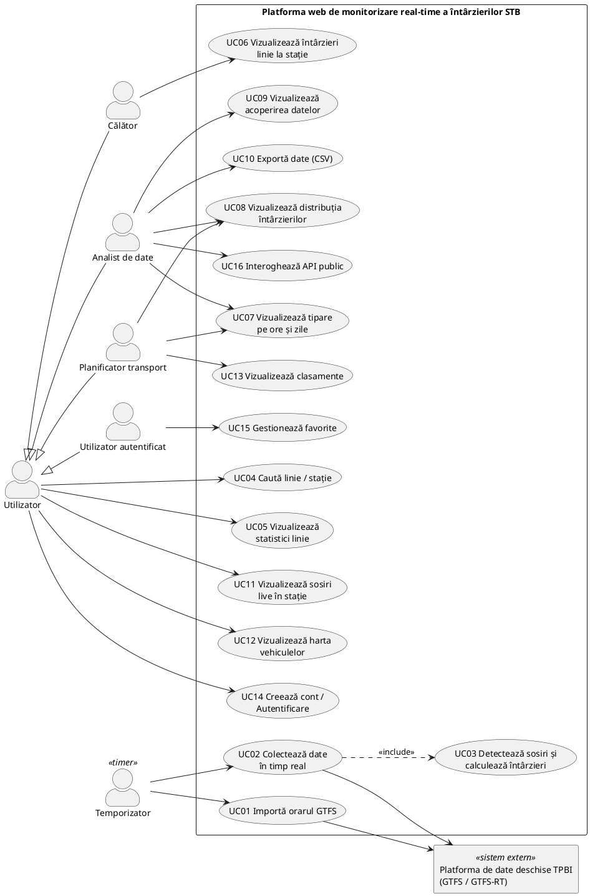

# Requirements Document - Platforma web de monitorizare real-time a întârzierilor STB

## Echipa

| Rol | Membru |
|---|---|
| Product Owner | Țuinea Mihai |
| Scrum Master (și Developer) | Ionescu Andrei |
| Developer | Opran Andrei |

## 1. Descrierea problemei

Transportul public de suprafață din București-Ilfov (autobuz, tramvai, troleibuz) este planificat de ADI Transport Public București-Ilfov (TPBI) și operat de STB și de operatori regionali din Ilfov. TPBI publică orarul în format deschis GTFS și, separat, date în timp real în format GTFS-Realtime: poziția vehiculelor și ore estimate de sosire.

Datele în timp real descriu însă doar momentul curent. După ce un vehicul a trecut de o stație, informația despre cât a întârziat nu mai este disponibilă nicăieri. Nu există un istoric public al întârzierilor, ceea ce înseamnă că:

- călătorul nu poate afla cât de fiabilă este, de obicei, o linie la stația lui și la ora la care circulă;
- analiștii și cercetătorii nu au un set de date deschis pentru studii de punctualitate;
- planificatorii nu pot identifica ușor, pe baza datelor, liniile, stațiile și intervalele orare cu întârzieri recurente.

**Platforma web de monitorizare real-time a întârzierilor STB** colectează continuu datele în timp real, determină momentul real al sosirii fiecărui vehicul în fiecare stație, îl compară cu ora din orar și construiește un set de date istoric al întârzierilor. Setul de date este pus la dispoziție prin statistici, vizualizări, export și API.

### 1.1 Surse de date

| Sursă | URL | Conținut |
|---|---|---|
| Orar static GTFS | `https://gtfs.tpbi.ro/regional/BUCHAREST-REGION.zip` | 201 rute; versiunea 6.41, valabilă 07.10.2026 - 05.01.2027 |
| GTFS-RT Vehicle Positions | `https://gtfs.tpbi.ro/api/gtfs-rt/vehiclePositions` | poziția vehiculului, cursa (`trip_id`), stația curentă, starea (`STOPPED_AT` / `IN_TRANSIT_TO`), gradul de ocupare |
| GTFS-RT Trip Updates | `https://gtfs.tpbi.ro/api/gtfs-rt/tripUpdates` | ore estimate de sosire în fiecare stație, pentru fiecare cursă |
| GTFS-RT Service Alerts | `https://gtfs.tpbi.ro/api/gtfs-rt/serviceAlerts` | anunțuri de serviciu |

Fluxurile sunt publice, fără cheie de acces. Termenii de utilizare a datelor deschise sunt publicați de TPBI pe platforma mo-bi.ro.

**Verificare de fezabilitate** (pe un instantaneu al fluxurilor):

- 842 de vehicule în fluxul de poziții, 1381 de curse în fluxul de estimări;
- 100% din identificatorii de cursă și de stație din fluxurile în timp real se regăsesc în orarul static, deci întârzierea se poate calcula pentru fiecare pereche cursă-stație;
- estimările diferă real de orar (mediana +17 s; 10% din estimări cu peste 6,4 minute întârziere), deci fluxul nu repetă doar orarul;
- metroul (M1-M5) apare în orarul static, dar nu și în fluxurile în timp real, deci nu poate intra în setul de date;
- ambele fluxuri în timp real se actualizează aproximativ la fiecare 15 secunde; la fiecare actualizare, circa 70% din vehicule primesc o poziție nouă.

## 2. Utilizatori

| Categorie | Descriere | Nevoi principale |
|---|---|---|
| **Călător** | Persoană care folosește transportul public, zilnic sau ocazional. | Cât întârzie de obicei linia la stația și la ora la care circulă; când sosește următorul vehicul; unde se află acum vehiculul. |
| **Analist de date / cercetător** | Student, cercetător, jurnalist de date sau dezvoltator care studiază punctualitatea transportului. | Set de date complet și filtrabil; export; acces programatic; informații despre completitudinea datelor. |
| **Planificator transport** | Angajat al autorității de transport sau al unui operator, ori consultant în mobilitate urbană. | Tipare de întârziere pe ore și zile; clasamente ale liniilor și stațiilor problematice. |

Toate categoriile pot folosi aplicația fără cont. Contul (**utilizator autentificat**) este necesar doar pentru salvarea liniilor și stațiilor favorite.

Actori secundari:

- **Platforma de date deschise TPBI**: sistem extern, furnizorul datelor GTFS și GTFS-RT;
- **Temporizator**: actor de tip timer, declanșează automat importul periodic al orarului și interogarea fluxurilor în timp real.

## 3. Cerințe funcționale

### 3.1 Colectarea datelor

| ID | Cerință |
|---|---|
| FR-01 | Sistemul descarcă zilnic orarul GTFS publicat de TPBI, detectează o versiune nouă (după `feed_version`) și o importă fără a afecta datele colectate anterior. |
| FR-02 | Sistemul interoghează fluxurile GTFS-RT Vehicle Positions și Trip Updates la un interval fix de 15 secunde, egal cu frecvența de actualizare a fluxurilor. |
| FR-03 | Sistemul detectează sosirea unui vehicul într-o stație: trecerea în starea `STOPPED_AT` sau avansul secvenței curente de stație. Pentru stațiile parcurse între două interogări folosește ultima estimare din Trip Updates. |
| FR-04 | Sistemul calculează întârzierea fiecărei sosiri, în secunde, ca diferență între ora reală și ora programată. Ora programată se calculează pornind de la data de start a cursei, inclusiv pentru orele GTFS de peste 24:00 și în nopțile cu schimbarea orei. |
| FR-05 | Sistemul stochează fiecare sosire: data de serviciu, cursa, linia, stația, secvența, ora programată, ora reală, întârzierea, metoda de detecție, vehiculul. Ora programată se salvează în înregistrare, astfel încât datele rămân valide după schimbarea versiunii orarului. |
| FR-06 | Sistemul înregistrează perioadele în care colectarea nu a funcționat (goluri de date) și le afișează. |

### 3.2 Căutare și statistici istorice

| ID | Cerință |
|---|---|
| FR-07 | Utilizatorul poate căuta o linie după număr și o stație după nume. |
| FR-08 | Utilizatorul poate vedea statisticile unei linii pe un interval ales: număr de observații, întârziere medie, mediană, percentila 90, procent de sosiri la timp (o sosire este la timp dacă întârzierea este între -1 min și +3 min față de orar). |
| FR-09 | Utilizatorul poate vedea statisticile unei stații, total și pentru fiecare linie care o deservește, opțional filtrate pe un interval orar. |
| FR-10 | Utilizatorul poate vedea întârzierea medie a unei linii pe ore ale zilei și pe zile ale săptămânii. |
| FR-11 | Utilizatorul poate vedea distribuția întârzierilor unei linii (histogramă). |
| FR-12 | Utilizatorul poate vedea clasamentul liniilor și stațiilor după întârziere, pe un interval ales. |

### 3.3 Timp real

| ID | Cerință |
|---|---|
| FR-13 | Utilizatorul poate vedea următoarele sosiri într-o stație, cu întârzierea estimată. |
| FR-14 | Utilizatorul poate vedea pe hartă vehiculele în circulație, colorate după întârziere, cu filtrare pe linie. |

### 3.4 Export și API

| ID | Cerință |
|---|---|
| FR-15 | Utilizatorul poate exporta înregistrările de sosire în format CSV, filtrate după linie, stație și interval. |
| FR-16 | Sistemul oferă un API REST public, documentat în format OpenAPI, pentru interogarea statisticilor și a sosirilor înregistrate. |

### 3.5 Conturi

| ID | Cerință |
|---|---|
| FR-17 | Utilizatorul își poate crea un cont cu e-mail și parolă, se poate autentifica, deconecta și își poate șterge contul. |
| FR-18 | Utilizatorul autentificat poate salva linii și stații favorite în cont și le poate vedea pe un panou personal. |

## 4. Cerințe nefuncționale

| ID | Categorie | Cerință |
|---|---|---|
| NFR-01 | Disponibilitate | Colectorul rulează 24/7 pe un server (VPS) și repornește automat după o eroare. Întreruperile sunt înregistrate (FR-06). |
| NFR-02 | Conformitate | Se respectă termenii de utilizare a datelor deschise TPBI. Fluxurile nu sunt interogate mai des de o dată la 15 secunde. |
| NFR-03 | Corectitudine | Toate orele sunt tratate în fusul orar Europe/Bucharest. Orele GTFS de peste 24:00 și schimbarea orei (ex. 25.10.2026) sunt tratate corect. |
| NFR-04 | Performanță | Statisticile unei linii pe un interval de 30 de zile se încarcă în mai puțin de 2 secunde. Datele afișate în timp real au o vechime de cel mult 30 de secunde. |
| NFR-05 | Volum de date | Stocarea suportă ordinul sutelor de mii de înregistrări pe zi, pe durata a mai multe luni. |
| NFR-06 | Securitate | Parolele sunt stocate doar ca hash (bcrypt sau argon2). Comunicarea se face prin HTTPS. Sesiunea folosește un token cu expirare. |
| NFR-07 | Date personale | Contul reține doar e-mailul și hash-ul parolei. Ștergerea contului elimină toate datele utilizatorului (GDPR). |
| NFR-08 | Utilizabilitate | Interfața este în limba română și se poate folosi pe telefon (design responsiv). |
| NFR-09 | Monitorizare | Un endpoint de stare (health) raportează ora ultimei interogări reușite și a ultimului import de orar. |
| NFR-10 | Testare | Teste automate (pytest pentru backend; framework-ul pentru frontend se stabilește ulterior), cu măsurarea code coverage. Aproximativ jumătate din User Stories implementate se dezvoltă prin TDD. |
| NFR-11 | Tehnologii | Backend FastAPI (Python), frontend React, bază de date PostgreSQL, rulare cu Docker Compose, cod sursă în Git, găzduit pe GitHub; managementul proiectului în GitHub Projects. |

## 5. Product Goal

> **Propunere, de validat de Product Owner:**
>
> Platforma web de monitorizare real-time a întârzierilor STB oferă călătorilor, analiștilor și planificatorilor din București-Ilfov un istoric deschis, actualizat continuu, al întârzierilor reale ale transportului public de suprafață, pe fiecare linie și stație, care arată cât de punctual este fiecare traseu.

## 6. Use Case Diagram

### 6.1 Lista cazurilor de utilizare

Numerotarea cazurilor de utilizare corespunde User Stories din [02-user-stories.md](02-user-stories.md) (UCxx = US-xx).

| UC | Nume | Actori | Cerințe |
|---|---|---|---|
| UC01 | Importă orarul GTFS | Temporizator, Platforma de date deschise TPBI | FR-01 |
| UC02 | Colectează date în timp real | Temporizator, Platforma de date deschise TPBI | FR-02, FR-03 |
| UC03 | Detectează sosiri și calculează întârzieri | (inclus în UC02) | FR-03, FR-04, FR-05 |
| UC04 | Caută linie / stație | Utilizator | FR-07 |
| UC05 | Vizualizează statistici linie | Utilizator | FR-08 |
| UC06 | Vizualizează întârzieri linie la stație | Călător | FR-09 |
| UC07 | Vizualizează tipare pe ore și zile | Planificator, Analist | FR-10 |
| UC08 | Vizualizează distribuția întârzierilor | Planificator, Analist | FR-11 |
| UC09 | Vizualizează acoperirea datelor | Analist | FR-06 |
| UC10 | Exportă date (CSV) | Analist | FR-15 |
| UC11 | Vizualizează sosiri live în stație | Utilizator | FR-13 |
| UC12 | Vizualizează harta vehiculelor | Utilizator | FR-14 |
| UC13 | Vizualizează clasamente | Planificator | FR-12 |
| UC14 | Creează cont / Autentificare | Utilizator | FR-17 |
| UC15 | Gestionează favorite | Utilizator autentificat | FR-18 |
| UC16 | Interoghează API public | Analist | FR-16 |

## 7. Ipoteze și constrângeri

- Fluxurile TPBI rămân disponibile public, fără cheie de acces.
- Metroul nu este acoperit, deoarece nu are date în timp real în fluxurile TPBI.
- Precizia orei de sosire depinde de intervalul de interogare (15 s) și de calitatea datelor GPS transmise de operatori.
- La un interval de 15 s, colectorul descarcă aproximativ 3,3 GB pe zi (circa 100 GB pe lună), deoarece fluxurile nu sunt comprimate. Serverul VPS trebuie ales în funcție de acest trafic.
- Serverul TPBI (protejat de Cloudflare) respinge cu HTTP 403 cererile care au User-Agent-ul implicit al bibliotecii Python urllib. Colectorul trimite un User-Agent propriu, care identifică proiectul.
- Orarul static curent expiră la 05.01.2027. Aplicația trebuie să preia automat versiunea nouă (FR-01).
- Setul de date crește doar cât timp colectorul rulează. Cu cât colectorul pornește mai devreme, cu atât perioada acoperită la prezentarea finală este mai lungă.

## 8. Riscuri

| Risc | Impact | Măsură |
|---|---|---|
| TPBI modifică, restricționează sau oprește fluxurile | Colectarea se oprește | Monitorizare (NFR-09); golurile sunt înregistrate (FR-06) |
| Vehiculele sunt surprinse rar în starea `STOPPED_AT` | Sosiri lipsă | Completare din estimările Trip Updates (FR-03); măsurarea ratei de captare la începutul proiectului |
| Poziții GPS vechi sau eronate (în proba analizată, unele poziții aveau o vechime de până la ~25 min) | Întârzieri false | Ignorarea pozițiilor mai vechi decât un prag stabilit |
| Volum mare de date | Interogări lente | Partiționarea tabelului de sosiri; agregări precalculate |
| Schimbarea versiunii orarului (identificatori de cursă noi) | Asocieri greșite cu orarul | Ora programată salvată în fiecare înregistrare (FR-05) |

## 9. Decizii

### 9.1 Decizii luate

| Nr. | Decizie | Motivare |
|---|---|---|
| 1 | O sosire este "la timp" dacă întârzierea este între -1 min și +3 min față de orar. | Toleranța acoperă abaterile mici, normale în trafic, și precizia de aproximativ 15 s a detecției sosirilor. |
| 2 | Codul sursă este găzduit pe GitHub, iar managementul proiectului se face în GitHub Projects. | Repository-ul, Pull Request-urile și board-ul de task-uri sunt în același loc, iar task-urile se pot lega direct de commit-uri și PR-uri. |
| 3 | Fluxurile în timp real sunt interogate la fiecare 15 secunde. | Măsurătorile arată că TPBI actualizează ambele fluxuri aproximativ la fiecare 15 s. O interogare mai deasă nu aduce date noi, iar una mai rară (ex. 20 s) pierde o parte din actualizări și scade precizia orei de sosire. Valoarea respectă și limita din NFR-02. |

### 9.2 Decizii deschise

1. Numele scurt al produsului (numele complet: Platforma web de monitorizare real-time a întârzierilor STB).
2. Framework-ul de testare pentru frontend.
