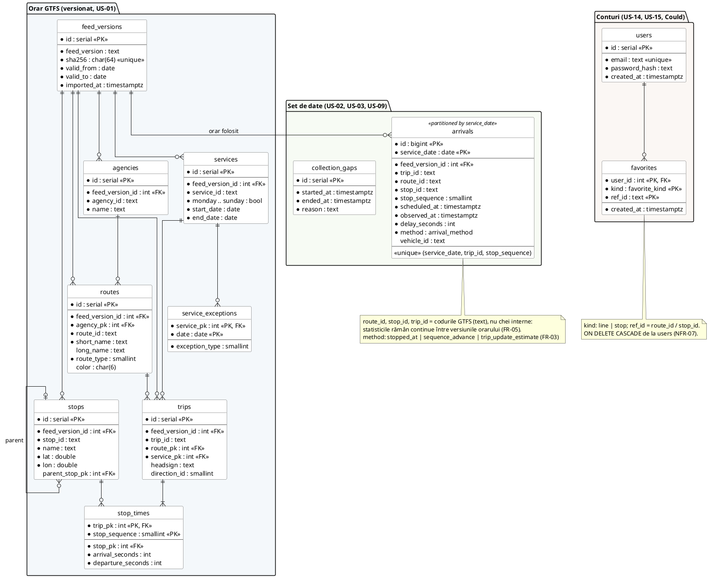

# Modelul de date - propunere

**Stare:** propunere, de discutat și aprobat de echipă la Sprint Planning. După aprobare devine prima migrație Alembic.

Sursa diagramei: [diagrams/erd.puml](diagrams/erd.puml) (PlantUML).

## 1. Principii

### 1.1 Orarul este versionat

Fiecare versiune a orarului GTFS (o arhivă `static/*.zip` salvată de T-01) se importă separat, cu legătura `feed_version_id`. O versiune nouă nu modifică datele vechi (FR-01).

Motiv: reprocesarea arhivei în timp real (colectată din 29.10.2026) trebuie să folosească orarul valabil în ziua respectivă. La o versiune nouă, identificatorii curselor se pot schimba.

În interiorul unei versiuni, tabelele folosesc chei numerice interne (`id`), iar codul GTFS (`route_id`, `stop_id`, `trip_id`) rămâne unic per versiune. `stop_times` are ~1,45 milioane de rânduri pe versiune; cheile numerice îl păstrează compact.

### 1.2 Sosirile folosesc codurile GTFS, nu cheile interne

`arrivals` stochează `route_id`, `stop_id` și `trip_id` ca text (codurile din GTFS) și ora programată (`scheduled_at`) în fiecare înregistrare (FR-05). Astfel:

- statisticile unei linii sau stații sunt continue între versiunile orarului (linia `112` rămâne `112`);
- o înregistrare rămâne validă chiar dacă versiunea de orar se schimbă sau este ștearsă.

`feed_version_id` arată ce versiune de orar a fost folosită la calcul.

### 1.3 Orele

- În `stop_times`, orele se stochează ca secunde față de începutul zilei de serviciu (`arrival_seconds`). Orele GTFS pot depăși 24:00 (maximul în orarul actual: 25:10).
- `scheduled_at` se calculează conform specificației GTFS: ora 12:00 a zilei de serviciu, în Europe/Bucharest, minus 12 h, plus `arrival_seconds`. Așa se tratează corect și noaptea schimbării orei (NFR-03).
- Toate momentele se stochează ca `timestamptz`; afișarea se face în Europe/Bucharest.

### 1.4 O singură sosire pe (zi, cursă, stație)

Constrângerea unică `(service_date, trip_id, stop_sequence)` garantează criteriul de acceptare din US-02: o singură înregistrare pentru perechea (cursă, dată, stație). Reprocesarea aceleiași perioade folosește `INSERT ... ON CONFLICT` și produce aceleași sosiri.

### 1.5 Partiționare după dată

`arrivals` este partiționat lunar după `service_date` (NFR-05). Volum estimat din orarul actual (fără metrou): ~600 000 de opriri programate într-o zi lucrătoare, ~405 000 sâmbăta sau duminica, deci până la ~18 milioane de înregistrări pe lună (~100 MB pe zi cu indexuri). Interogările pe un interval citesc doar partițiile necesare (NFR-04).

## 2. Tabele

### 2.1 Orar GTFS (US-01)

| Tabel | Sursă GTFS | Observații |
|---|---|---|
| `feed_versions` | `feed_info.txt`, arhiva | `sha256` unic: aceeași arhivă nu se importă de două ori. `valid_from` / `valid_to` din `calendar.txt`. |
| `agencies` | `agency.txt` | STB, STV, STCM, Regio Serv, Metrorex |
| `routes` | `routes.txt` | `route_type`: 0 tramvai, 3 autobuz, 11 troleibuz, 1 metrou |
| `stops` | `stops.txt` | `parent_stop_pk` pentru stațiile cu mai multe peroane |
| `services` | `calendar.txt` | zilele în care circulă o cursă (ex. `LV` = luni-vineri) |
| `service_exceptions` | `calendar_dates.txt` | gol în versiunea actuală, păstrat pentru versiunile viitoare |
| `trips` | `trips.txt` | |
| `stop_times` | `stop_times.txt` | cheie primară `(trip_pk, stop_sequence)` |

Nu se importă: `shapes.txt` (eventual mai târziu, pentru harta din US-12), tarife, transferuri, `pathways.txt`, `levels.txt`, `translations.txt`.

### 2.2 Set de date (US-02, US-03, US-09)

**`arrivals`** (FR-05)

| Coloană | Tip | Descriere |
|---|---|---|
| `id` | bigint | identificator |
| `service_date` | date | ziua de serviciu (`start_date` din GTFS-RT) |
| `feed_version_id` | int | versiunea de orar folosită |
| `trip_id`, `route_id`, `stop_id` | text | coduri GTFS |
| `stop_sequence` | smallint | poziția stației în cursă |
| `scheduled_at` | timestamptz | ora programată |
| `observed_at` | timestamptz | ora reală (detectată) |
| `delay_seconds` | int | `observed_at - scheduled_at`; negativ = mai devreme |
| `method` | enum | `stopped_at`, `sequence_advance`, `trip_update_estimate` (FR-03) |
| `vehicle_id` | text | vehiculul (opțional) |

**`collection_gaps`** (FR-06): intervalele fără date, calculate din `polls/*.jsonl` ale colectorului. Un gol = un interval mai mare decât pragul ales (propunere: 60 s) între două interogări reușite.

### 2.3 Conturi (US-14, US-15, Could)

Incluse în diagramă pentru imaginea completă; se creează doar dacă poveștile intră în Sprint.

- `users`: doar e-mailul și hash-ul parolei (NFR-06, NFR-07).
- `favorites`: `kind` = `line` sau `stop`, `ref_id` = `route_id` / `stop_id`. Ștergerea contului șterge favoritele (`ON DELETE CASCADE`, GDPR).

## 3. Indexuri propuse

| Tabel | Index | Pentru |
|---|---|---|
| `routes` | `(feed_version_id, route_id)` unic, `short_name` | import, căutare linie (US-04) |
| `stops` | `(feed_version_id, stop_id)` unic, `name` (trigram, `pg_trgm`) | import, căutare stație după nume (US-04) |
| `trips` | `(feed_version_id, trip_id)` unic | potrivirea cu GTFS-RT (US-02) |
| `arrivals` | `(route_id, service_date)`, `(stop_id, service_date)` | statistici linie / stație (US-05, US-06, US-07) |

## 4. Trasabilitate

| Tabel | Cerințe | User Stories |
|---|---|---|
| orar GTFS | FR-01 | US-01, US-04, US-11 |
| `arrivals` | FR-03, FR-04, FR-05, NFR-03, NFR-05 | US-02, US-03, US-05...US-08, US-10, US-13 |
| `collection_gaps` | FR-06 | US-09 |
| `users`, `favorites` | FR-17, FR-18, NFR-06, NFR-07 | US-14, US-15 |

## 5. De decis de echipă

1. **Pragul pentru goluri de date:** 60 s (propunere) sau altă valoare.
2. **Partiționarea:** lunară (propunere) sau deloc la început, adăugată când volumul o cere.
3. **Zilele de sărbătoare:** orarul actual nu are `calendar_dates`, deci pentru 30.11, 1.12, 25-26.12 și 1-2.01 orarul declarat poate diferi de cel real. Propunere: marcarea acestor zile și excluderea lor din statistici (sau afișarea separată).
4. **Unde rulează baza de date:** pe VPS, discul de 38 GB este folosit deja de arhiva brută (T-02). La ~100 MB pe zi, `arrivals` mai adaugă câțiva GB până la prezentarea finală. De decis împreună cu T-02.
